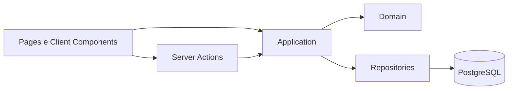
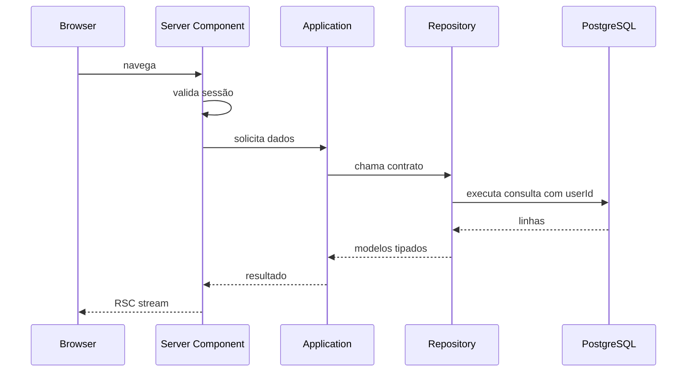
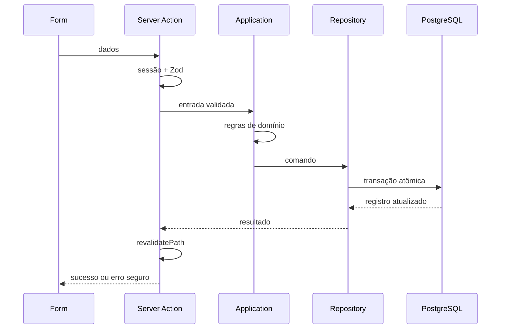

# Arquitetura

## Visão geral

O Wallai utiliza um monólito modular. A aplicação, os casos de uso e o acesso ao
banco são publicados juntos, mas as responsabilidades são separadas por
camadas e domínios.



Essa estrutura permite crescer sem introduzir a complexidade operacional de
microsserviços antes de existir uma necessidade concreta.

## Camadas

### `src/app`

Contém as rotas do App Router.

- páginas são Server Components por padrão;
- componentes interativos ficam próximos das respectivas rotas;
- `loading.tsx` fornece feedback imediato durante navegações;
- o dashboard usa `Suspense` para transmitir indicadores, gráficos e
  compromissos separadamente;
- o layout autenticado valida a sessão e renderiza a navegação.

### `src/actions`

Fronteira de mutação da aplicação.

Responsabilidades:

- validar entrada com Zod;
- exigir sessão com `authenticatedAction`;
- chamar um caso de uso;
- converter erros conhecidos em mensagens seguras;
- revalidar as rotas afetadas.

Server Actions não devem conter regra financeira ou acesso direto ao banco.

### `src/modules`

Contém domínio e aplicação, sem dependência do framework ou do Drizzle.

```text
modules/<domínio>/
├── domain/       # entidades, tipos, cálculos e invariantes
└── application/  # casos de uso e contratos de repositório
```

Os casos de uso recebem dependências por parâmetro. Isso mantém as regras
testáveis sem banco real.

### `src/services`

Implementa os contratos definidos pela camada de aplicação.

- consultas e mutações Drizzle;
- transações de banco;
- proteção de escopo por usuário;
- persistência de parcelas e faturas;
- processamento em lote de recorrências.

O factory `createRepositories(userId)` cria repositórios limitados ao usuário
autenticado. `assertUserScope` adiciona uma segunda verificação antes das
consultas.

### `src/db`

- `auth-schema.ts`: tabelas do Better Auth;
- `schema.ts`: tabelas e constraints financeiras;
- `schema-relations.ts`: relações Drizzle;
- `index.ts`: criação do cliente PostgreSQL.

## Fluxo de leitura



## Fluxo de mutação



## Autenticação e autorização

O Better Auth fornece:

- e-mail e senha;
- login Google;
- sessões persistidas no PostgreSQL.

O proxy verifica a presença do cookie antes de permitir `/dashboard`. A
autorização efetiva ocorre no servidor por `requireSession`; a checagem do
cookie é apenas uma barreira antecipada.

Todas as entidades financeiras possuem `user_id`. Repositórios combinam o ID da
entidade com o usuário autenticado, evitando acesso horizontal entre contas.

## Tratamento de erros

Erros de regra usam `BusinessError`, com código estável e mensagem legível.

```text
Domain/Application → BusinessError
Server Action       → handleActionError
Client              → mensagem segura
```

Erros inesperados são registrados no servidor e retornam uma mensagem genérica,
sem expor detalhes internos.

## Decisões arquiteturais

- valores monetários são inteiros em centavos;
- datas persistidas usam timestamp com timezone;
- compras no crédito não movimentam uma conta diretamente;
- pagamentos de fatura e dívida criam lançamentos relacionados;
- operações compostas usam transações PostgreSQL;
- dados derivados, como saldo e limite utilizado, são calculados a partir dos
  registros financeiros;
- Server Components são preferidos; Client Components existem apenas para
  formulários, tabelas e interações.

## Direção de crescimento

Antes de separar microsserviços:

1. aplicar paginação server-side nas demais listagens;
2. adicionar observabilidade e métricas de consulta;
3. fortalecer idempotência e histórico dos jobs;
4. adicionar rate limiting;
5. consolidar migrations versionadas.

IA, notificações e importações bancárias são candidatos naturais a workers ou
serviços separados caso passem a exigir escala e deploy independentes.

