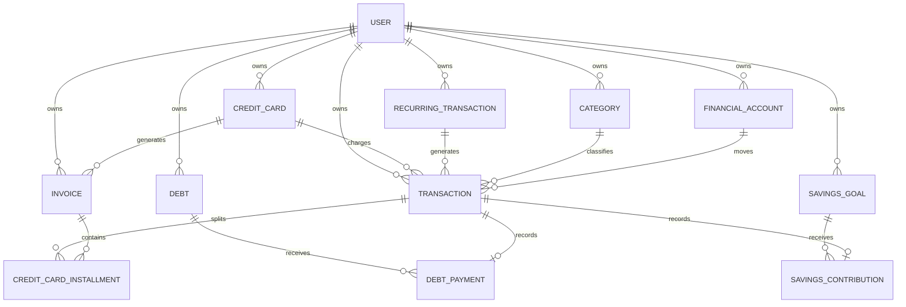

# Banco de dados

## Tecnologia

O projeto utiliza PostgreSQL com Drizzle ORM. Os schemas TypeScript são a
representação do modelo relacional:

- `src/db/auth-schema.ts`;
- `src/db/schema.ts`;
- `src/db/schema-relations.ts`.

## Entidades principais



## Tabelas financeiras

| Tabela | Responsabilidade |
| --- | --- |
| `financial_account` | contas e saldo inicial |
| `category` | classificação de receitas e despesas |
| `credit_card` | limite e configuração do ciclo |
| `invoice` | ciclos e pagamentos do cartão |
| `transaction` | fatos financeiros centrais |
| `credit_card_installment` | parcelas associadas a compras e faturas |
| `debt` | obrigações financeiras |
| `debt_payment` | vínculo entre dívida e pagamento |
| `savings_goal` | cofrinhos e objetivos |
| `savings_contribution` | vínculo entre cofrinho e aporte |
| `recurring_transaction` | definição e agenda de recorrências |

## Integridade

O schema usa:

- UUID como chave primária nas entidades financeiras;
- chaves estrangeiras com política explícita de exclusão;
- índices compostos por usuário e campos de consulta;
- unicidade de nomes dentro do usuário quando aplicável;
- checks para valores, datas e estados válidos;
- chave composta para garantir que categoria e transação pertençam ao mesmo
  usuário;
- unicidade de cartão e início do ciclo para impedir duas faturas do mesmo
  período.

Toda consulta de entidade financeira deve incluir `user_id`, mesmo quando o ID
primário já é conhecido.

## Transações atômicas

São obrigatórias nos fluxos compostos:

- criação e cancelamento de compra parcelada;
- fechamento e pagamento de fatura;
- pagamento de dívida;
- aporte em cofrinho;
- processamento de recorrência.

Uma falha intermediária deve desfazer toda a operação.

## Evolução do schema

Para desenvolvimento local, o schema pode ser sincronizado com:

```bash
pnpm exec drizzle-kit push
```

O repositório ainda não mantém migrations versionadas. Antes de novas mudanças
em produção, recomenda-se adotar:

```bash
pnpm exec drizzle-kit generate --name nome_da_mudanca
pnpm exec drizzle-kit migrate
```

Revise sempre o SQL gerado e mantenha backup antes de alterações destrutivas.
`push` é conveniente para desenvolvimento, mas não substitui uma estratégia de
migrations auditável em produção.

## Convenções

- nomes SQL usam `snake_case`;
- nomes TypeScript usam `camelCase`;
- valores monetários usam sufixo `InCents`;
- timestamps usam timezone e precisão de milissegundos;
- estados são enums PostgreSQL com prefixo `finance_`.

