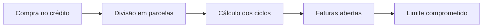

# Regras de domínio

## Valores monetários

Todos os valores são armazenados como inteiros em centavos.

```text
R$ 149,90 → 14990
```

Isso evita erros de ponto flutuante. Valores financeiros devem ser positivos,
inteiros e menores ou iguais a `Number.MAX_SAFE_INTEGER`.

## Contas

Tipos disponíveis:

- `CHECKING`: conta corrente;
- `SAVINGS`: conta poupança;
- `CASH`: dinheiro;
- `INVESTMENT`: investimentos.

O saldo é calculado por:

```text
saldo inicial
+ receitas liquidadas
- despesas liquidadas
```

Compras no crédito não afetam a conta. A conta é movimentada apenas quando a
fatura é paga. Contas desativadas deixam de aceitar novas movimentações.

## Categorias

Tipos:

- `INCOME`: somente receitas;
- `EXPENSE`: somente despesas;
- `BOTH`: receitas e despesas.

Uma transação padrão exige categoria compatível com seu tipo. Aportes em
cofrinhos são movimentações internas e não utilizam categoria.

## Lançamentos

### Tipos

- `INCOME`;
- `EXPENSE`.

### Status

- `PENDING`: previsto, ainda não afeta o saldo;
- `SETTLED`: liquidado e efetivo;
- `CANCELLED`: cancelado e ignorado nos cálculos.

### Origens

- `STANDARD`: lançamento financeiro comum;
- `SAVINGS_CONTRIBUTION`: transferência interna para cofrinho.

### Formas de pagamento

- dinheiro;
- PIX;
- cartão de débito;
- transferência bancária;
- cartão de crédito.

Lançamentos fora do crédito exigem `accountId`. Compras no crédito exigem
`creditCardId`, não aceitam `accountId` e são sempre despesas.

O cancelamento de uma compra no crédito também remove seu efeito das parcelas e
das faturas relacionadas, respeitando o estado atual da fatura.

## Cartões, parcelas e limite

O limite comprometido é composto por:

```text
saldo das faturas não pagas
+ parcelas ainda não faturadas
```

Uma compra pode ter de 1 a 48 parcelas. O valor total é dividido em centavos;
eventuais centavos restantes são distribuídos entre as primeiras parcelas.

Cada parcela é associada ao ciclo calculado pela data da compra, dia de
fechamento e dia de vencimento do cartão.



Se a parcela cair em uma fatura que já não está aberta, a criação é rejeitada.

## Faturas

Status:

- `OPEN`: recebe novas parcelas;
- `CLOSED`: fechada e disponível para pagamento;
- `OVERDUE`: fechada e vencida com saldo;
- `PAID`: integralmente paga.

Uma fatura aberta só pode ser fechada após `closingAt`. O pagamento é permitido
para faturas fechadas ou vencidas e pode ser parcial.

O pagamento:

1. valida conta e categoria de despesa;
2. cria um lançamento de saída na conta;
3. incrementa `paidInCents`;
4. atualiza o status;
5. libera o limite proporcionalmente ao valor pago.

## Dívidas

Status:

- `OPEN`;
- `OVERDUE`;
- `PAID`;
- `CANCELLED`.

Pagamentos podem ser parciais, nunca podem superar o saldo devedor e geram um
lançamento de despesa ligado ao pagamento.

## Cofrinhos

O cofrinho é uma separação virtual de recursos, não um investimento.

Um aporte:

1. valida a conta ativa;
2. aumenta o valor guardado;
3. cria uma transação interna de saída;
4. não exige categoria;
5. conclui a meta quando o valor guardado alcança o objetivo.

Não há cálculo de CDI, juros ou rentabilidade.

## Recorrências

Frequências:

- semanal;
- mensal;
- anual.

O cadastro da recorrência não cria uma compra imediatamente. Quando
`nextOccurrenceAt` vence, o job:

1. valida categoria, conta ou cartão;
2. verifica o limite disponível;
3. cria um lançamento liquidado;
4. cria uma parcela de 1x quando for crédito;
5. avança a próxima ocorrência;
6. desativa ao ultrapassar a data final.

O processamento usa atualização condicional de `nextOccurrenceAt` para reduzir
risco de execução duplicada. O worker processa até 100 recorrências por lote e
até 24 ocorrências atrasadas de uma mesma recorrência.

## Dashboard

Indicadores e gráficos consideram:

- lançamentos liquidados;
- transações do período atual;
- exclusão de pagamentos de fatura para evitar dupla contagem;
- exclusão de aportes internos;
- despesas agrupadas pela categoria da transação;
- compromissos ainda não pagos.

Recorrências aparecem nos gráficos somente depois de gerarem uma transação.

## Limitações conhecidas

- não existe ação para pular apenas uma ocorrência;
- cartões e categorias ainda não possuem edição;
- alteração de categoria para `BOTH` ainda não foi implementada;
- recorrência no crédito usa o momento de processamento para escolher a fatura;
  se o job atrasar, a cobrança pode cair em ciclo diferente do agendado;
- apenas lançamentos possuem paginação server-side;
- não existe histórico próprio de ocorrências processadas, puladas ou falhas.

